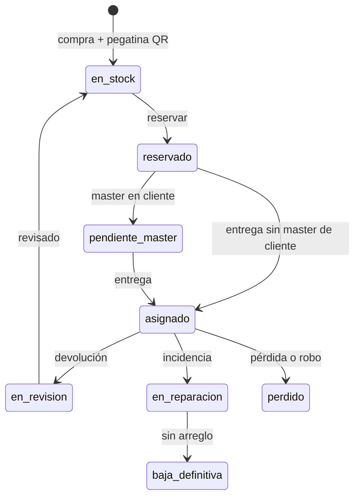

# Inventario IT — Especificación técnica

16 oct 2026 · Deni · Versión viva: https://claude.ai/code/artifact/1b9daf29-c98c-4326-b3d8-c61db22dfbf9

## Objetivo y alcance

El sistema responde a dos preguntas en todo momento: **dónde está cada equipo y quién lo tiene**, y **qué equipos están libres para asignar ahora**. Para ello registra el ciclo de vida completo del equipo, desde la compra hasta la baja, incluidas las asignaciones, la masterización y las incidencias.

**Dentro del alcance**

- Inventario de PCs, portátiles, monitores, docks, teclados, ratones, móviles y otros periféricos.
- Identificación por QR (pegatina que pone IT en la compra). Los teclados no llevan QR y se gestionan como accesorio o por número de serie.
- Altas y bajas de empleados, con la asignación y devolución de sus equipos.
- Clasificación por persona, proyecto y BU (unidad de negocio), con equipos compartidos entre varias BU.
- Ubicación: oficina propia o instalaciones de un cliente.
- Masterización: interna (CT) o en el dominio del cliente.
- Incidencias (teclas que fallan, pantalla, batería, etc.) con su seguimiento hasta el cierre.
- Web de gestión (escritorio) y PWA móvil con escaneo de QR.

**Fuera del alcance inicial**: compras y facturación, licencias de software y control remoto de equipos.

## Decisiones técnicas

| Capa | Decisión | Motivo |
| --- | --- | --- |
| Base de datos | MySQL 8.0+ (InnoDB, utf8mb4) | Integridad referencial, transacciones en asignaciones |
| Backend | Node.js 20 LTS + Express, `mysql2/promise` | API REST única para web y móvil |
| Frontend web | HTML5 + CSS + JavaScript vanilla | Sin build |
| Móvil | PWA (manifest + service worker), instalable en Android | Sin Play Store; misma API |
| Escaneo QR | `BarcodeDetector` nativo de Chrome Android; respaldo con `html5-qrcode` | Funciona en el navegador |
| Autenticación | Fase 1: usuario y contraseña propios (bcrypt + sesión en cookie httpOnly). Fase 2: Microsoft Entra ID (OIDC) | Arrancar rápido |
| Ficheros | Fotos de incidencias y actas firmadas en disco (Multer), ruta en BD | Simple |
| PDF | PDFKit para actas de entrega y devolución | Firma en pantalla (canvas) |
| Desarrollo / producción | XAMPP en local; en producción HTTPS obligatorio | La cámara de la PWA exige HTTPS |

**Entra ID**: `usuarios` guarda `auth_origen` (`local` o `entra`) y `entra_oid`; el login corporativo enlaza con el empleado por email.

**Uso fuera de la oficina**: la app se publica en internet. Las consultas del empleado funcionan sin conexión con la última copia cacheada; las escrituras requieren conexión.

## Roles y permisos

| Acción | Admin IT | Técnico IT | Responsable BU / proyecto | Empleado |
| --- | --- | --- | --- | --- |
| Dar de alta o de baja equipos | Sí | Sí | No | No |
| Asignar y devolver equipos | Sí | Sí | Solicita | No |
| Registrar masterización | Sí | Sí | No | No |
| Abrir incidencia | Sí | Sí | Sí | Sí, de sus equipos |
| Resolver incidencia | Sí | Sí | No | No |
| Ver equipos libres | Todos | Todos | Los de su BU | No |
| Ver inventario | Todo | Todo | Su BU / proyecto | Solo los suyos |
| Alta y baja de empleados | Sí | Sí | Notifica | No |
| Catálogos | Sí | No | No | No |
| Firmar acta de entrega | — | — | — | Sí |

El responsable **solicita** un equipo; IT aprueba y ejecuta la asignación.

## Ciclo de vida del equipo

Solo se puede asignar desde *En stock*, y toda devolución pasa por revisión antes de volver al stock.

Al repararse, un equipo vuelve al estado que tenía antes de la incidencia. El cambio de proyecto no cambia el estado, salvo que el nuevo cliente exija masterizar.

## Modelo de datos

Ver `database/schema.sql`. La clave del diseño es separar **el equipo** (lo que es) de **la asignación** (quién lo tiene, para qué proyecto y con qué fechas). El historial queda en `asignaciones` y la disponibilidad se calcula con la vista `v_equipos_disponibilidad`.

Reglas impuestas por la base de datos:

- Una sola asignación abierta por equipo: columna generada `abierta` con índice `UNIQUE`.
- `codigo_qr` es `UNIQUE` y admite NULL (teclados). Los equipos sin QR reciben `codigo_interno` automático (`TEC-000123`).
- Asignar, devolver o cambiar de estado se hace en una transacción que actualiza `equipos.estado`, `asignaciones` y `auditoria`.

## Flujos operativos

**1. Compra y alta de equipo**: IT pega el QR, lo escanea en la PWA; como no existe, abre el alta con el código relleno. Queda `en_stock`.

**2. Alta de empleado**: se crea en `pendiente_alta`; el sistema propone equipos libres y avisa si el cliente exige su dominio; IT reserva, prepara y entrega con acta firmada; el empleado pasa a `activo`.

**3. Asignación y cambio de proyecto**: asignar = escanear, elegir empleado, proyecto y ubicación, firmar. Cambiar de proyecto cierra la asignación y abre otra; si el nuevo cliente exige dominio, se crea masterización pendiente.

**4. Baja de empleado**: `fecha_baja_prevista` → `pendiente_baja` y lista de equipos a recoger; alerta 10 días antes; devolución con estado (`correcto`, `con_danos`, `falta_accesorio`) y acta; equipo a `en_revision`; el empleado pasa a `baja` solo sin asignaciones abiertas.

**5. Masterización**: interna (`pendiente` → `en_curso` → `completada`) o en dominio del cliente (`enviado_cliente` hasta confirmar hostname y dominio; alerta a los 15 días). Al volver de un cliente se exige master interna.

**6. Incidencias**: escanear QR → *Reportar incidencia* (categoría, descripción, fotos). IT prioriza, asigna sustituto si hace falta, envía a reparación (`en_reparacion`), resuelve o da de baja.

**7. Pérdida o robo**: incidencia `perdida_robo` → cierra asignación, equipo `perdido`, adjuntar denuncia.

## Disponibilidad

| Disponibilidad | Condición | Uso |
| --- | --- | --- |
| Libre ahora | `en_stock`, sin asignación ni incidencia abierta | Asignar hoy |
| Libre tras preparación | `en_revision` o `pendiente_master` sin incidencia abierta | Asignar en 1–3 días |
| Libre próximamente | Asignación abierta con `fecha_fin_prevista`, o empleado en `pendiente_baja` | Planificar |
| No disponible | `reservado`, `asignado`, `en_reparacion`, `perdido`, `baja_definitiva` | — |

Equipos compartidos: un responsable ve como libres los equipos donde su BU figura en `equipo_unidades`; asignar uno de otra BU principal se permite con aviso.

## API REST

Todas bajo `/api`, JSON, control de rol y ámbito en middleware.

| Método | Ruta | Uso |
| --- | --- | --- |
| POST | `/auth/login`, `/auth/logout` | Sesión local |
| GET | `/auth/me` | Usuario, roles y ámbito |
| GET | `/equipos/qr/:codigo` | Ficha por QR. 404 = alta nueva |
| GET / POST | `/equipos` | Listar con filtros / alta |
| GET / PATCH | `/equipos/:id` | Ficha / editar |
| GET | `/equipos/:id/historial` | Asignaciones, masters, incidencias, auditoría |
| POST | `/equipos/:id/estado` | Cambio de estado validado |
| GET | `/disponibilidad` | Libres, tras preparación y próximos |
| POST | `/asignaciones` | Asignar (firma base64) |
| POST | `/asignaciones/:id/devolver` | Devolver |
| POST | `/asignaciones/:id/cambiar-proyecto` | Cierra y abre asignación |
| GET | `/asignaciones/:id/acta.pdf` | Acta |
| GET / POST | `/empleados` | Listar / alta |
| PATCH | `/empleados/:id` | Editar, cambio de proyecto, baja prevista |
| GET | `/empleados/:id/equipos` | Equipos actuales |
| POST | `/empleados/:id/baja` | Cerrar baja |
| GET / POST / PATCH | `/masterizaciones` | Cola, solicitar, avanzar |
| GET / POST / PATCH | `/incidencias` | Listar, abrir con fotos, gestionar |
| GET / POST / PATCH | `/solicitudes` | Peticiones de responsables |
| GET | `/dashboard/resumen` | KPIs |
| GET | `/informes/inventario.xlsx` | Exportación |
| CRUD | `/catalogos/:tabla` | Solo admin IT |

## Pantallas

**Web**: Panel, Inventario, Ficha de equipo, Disponibilidad, Empleados, Altas y bajas, Masterización, Incidencias, Solicitudes, Catálogos.

**PWA**: Escanear (acciones según rol), escaneo en lote, inventario físico por ubicación, *Mis equipos*, *Mi equipo* (responsable).

**QR**: la pegatina contiene una URL, p. ej. `https://inventario.ctingenieros.es/q/CT-000123`. Con la cámara normal abre la ficha; dentro de la PWA se extrae el código. También se acepta el código solo.

## Alertas y seguridad

| Alerta | Cuándo | A quién |
| --- | --- | --- |
| Incorporación sin equipo reservado | 7 días antes de `fecha_alta` | IT |
| Baja con equipos por recoger | 10 días antes y el día | IT y responsable |
| Master en cliente sin confirmar | 15 días en `enviado_cliente` | IT |
| Préstamo vencido | `fecha_fin_prevista` superada | IT y empleado |
| Incidencia sin atender | 2 días laborables | IT |
| Garantía a punto de vencer | 60 días antes | Admin IT |
| Stock bajo de un tipo | Menos de N libres | Admin IT |

Seguridad: HTTPS, cookies `httpOnly`/`secure`/`SameSite=Lax`, bcrypt, bloqueo tras 5 intentos, `helmet`, límite de peticiones, sentencias preparadas, control de ámbito en servidor, adjuntos validados (máx. 10 MB), copias diarias, RGPD. Auditoría con antes/después en JSON.

## Fases

1. **Base**: schema, catálogos, login, alta y ficha de equipos, inventario, importación desde Excel.
2. **Asignaciones y PWA**: asignar, devolver, cambio de proyecto, actas, escaneo QR, *Mis equipos*, disponibilidad.
3. **Ciclo completo**: altas y bajas, masterización, incidencias, solicitudes, alertas.
4. **Mejoras**: KPIs, informes, inventario físico, Entra ID.

## Preguntas abiertas

- [ ] ¿También móviles, licencias o tarjetas de acceso?
- [ ] ¿Hay un Excel actual que importar? ¿Columnas?
- [ ] ¿Equipos compartidos con porcentaje de coste o solo qué BU pueden usarlos?
- [ ] ¿Clientes que prestan equipos propios (`propiedad = cliente`)?
- [ ] ¿Quién comunica altas y bajas?
- [ ] ¿Teclados uno a uno con código interno o como consumible?
- [ ] ¿Alojamiento en producción: servidor propio o nube?
- [ ] ¿Firma del empleado en la entrega obligatoria?
